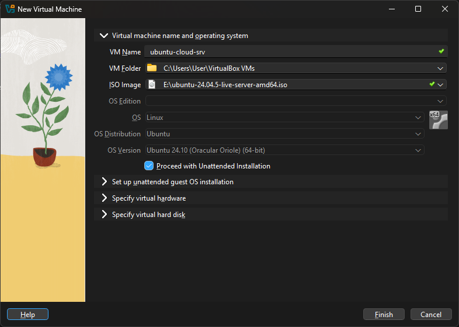
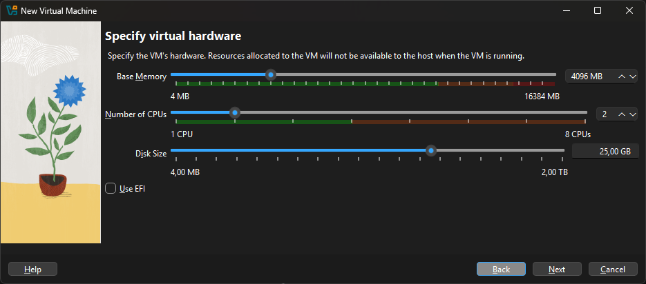
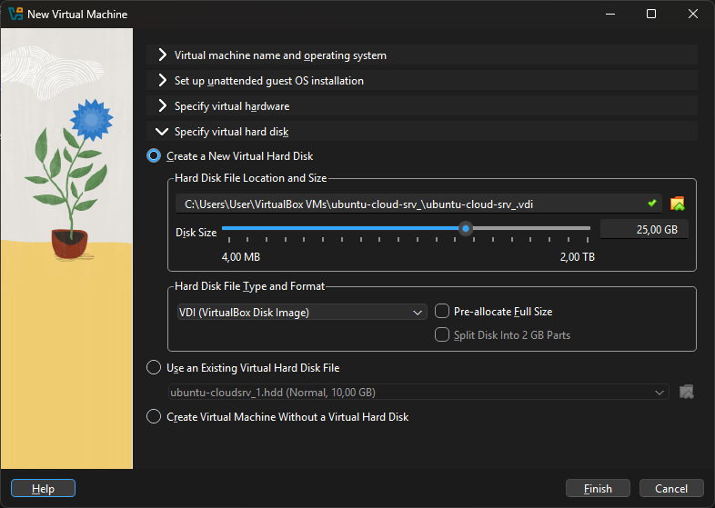
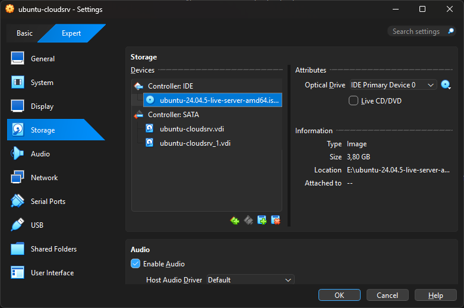
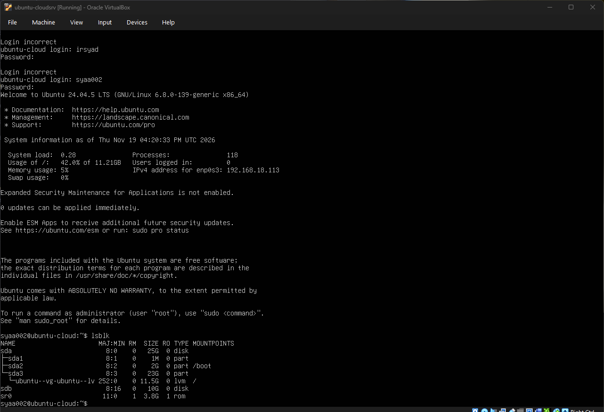
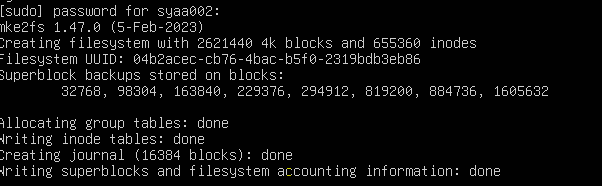
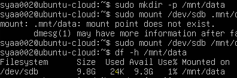
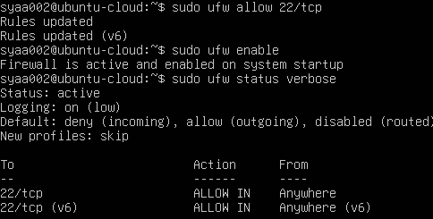
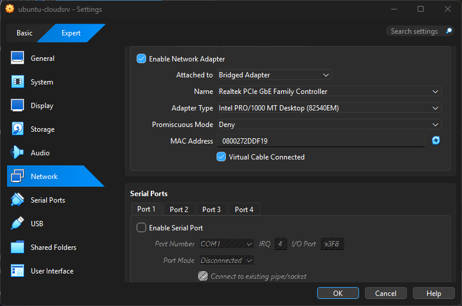
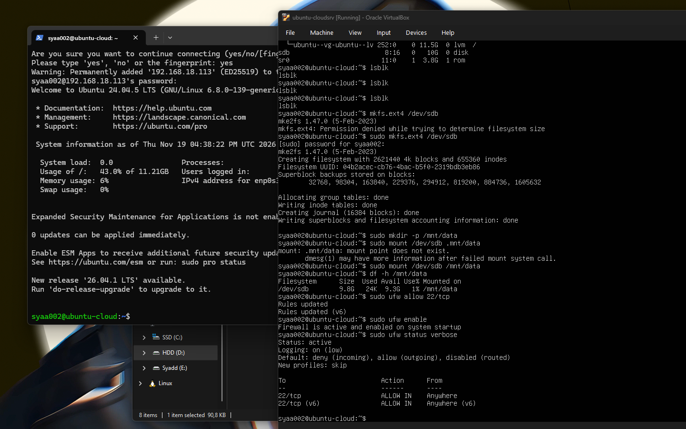

# Laporan Praktikum Cloud Computing: Panduan Deployment VM & Penyimpanan Cloud
**Ujian Tengah Semester (UTS) — INF61125 Cloud Computing**

| Informasi Mahasiswa | Data |
|---|---|
| **Nama Lengkap** | Ahmad Irsyadul Ibad |
| **NIM** | 240131003 |
| **Mata Kuliah** | Cloud Computing (INF61125) |
| **Pertemuan / Agenda** | Ujian Tengah Semester (Praktikum Pertemuan 3) |
| **Dosen Pengampu** | Andriyana, S.T., M.Kom. |
| **Program Studi** | S1 Informatika, Fakultas Teknik |
| **Perguruan Tinggi** | Universitas Sehati Indonesia |

---

## 1. Ringkasan Lingkungan Praktikum

Praktikum ini berfokus pada deployment instans *Virtual Machine* (VM) berbasis sistem operasi Linux, konfigurasi *Block Storage* tambahan, implementasi keamanan jaringan (*Security Group* / Firewall), serta pengujian konektivitas remote melalui protokol SSH.

Sebagai representasi layanan cloud computing (Infrastructure as a Service / IaaS), praktikum ini menggunakan **Oracle VM VirtualBox** pada sistem operasi Windows sebagai lingkungan simulasi cloud lokal (Type-2 Hypervisor). Seluruh tahapan dan arsitektur teknis mengadopsi standar penyedia cloud publik (seperti AWS EC2 & EBS, GCP Compute Engine & Persistent Disk, atau Oracle Cloud Infrastructure).

| Parameter Komponen | Spesifikasi & Konfigurasi |
|---|---|
| **Platform Virtualisasi** | Oracle VM VirtualBox (Host: Windows 11 x64) |
| **Sistem Operasi Tamu (VM)** | Ubuntu Server 24.04.5 LTS (x86_64, Kernel 6.8) |
| **Nama Instans VM / Hostname** | `ubuntu-cloudsrv` / `ubuntu-cloud` |
| **Username Sistem** | `syaa002` |
| **Kapasitas Komputasi** | 2 vCPU, RAM 4096 MB (4 GB) |
| **Penyimpanan Utama (Root OS)** | 25 GB VDI (`ubuntu-cloudsrv.vdi`, SATA Port 0) |
| **Block Storage Sekunder** | 10 GB VDI (`ubuntu-cloudsrv_1.vdi`, SATA Port 1, di-mount ke `/mnt/data`) |
| **Filesystem Storage Tambahan** | ext4 (UUID: `04b2acec-cb76-4bac-b5f0-2319bdb3eb86`) |
| **Mode Antarmuka Jaringan** | Bridged Adapter (Realtek PCIe GbE Family Controller) |
| **Alamat IP Instans** | `192.168.18.113` (IP jaringan lokal mandiri via DHCP) |
| **Firewall (Keamanan)** | UFW (*Uncomplicated Firewall*): Port 22/TCP diizinkan |
| **Akses Jarak Jauh** | OpenSSH Server (Akses via Windows Terminal: `ssh syaa002@192.168.18.113`) |

---

## 2. Langkah 1: Penyiapan Lingkungan & Penyedia Cloud

Pada praktikum ini, tahap pendaftaran akun cloud publik (Free Tier / GitHub Student Developer Pack) dialihkan menggunakan lingkungan virtualisasi lokal (VirtualBox) yang telah diizinkan sebagai alternatif deployment. Lingkungan ini mengisolasi sumber daya CPU, memori, media penyimpanan, dan jaringan menyerupai penyedia cloud publik:
* **Compute Engine**: Diwakili oleh mesin virtual berbasis kernel Linux Ubuntu 24.04.5 LTS x86_64.
* **Elastic Block Storage**: Diwakili oleh volume VDI dinamis independen yang dapat di-attach dan di-detach secara fleksibel.
* **Virtual Private Cloud (VPC) / Security Group**: Diwakili oleh konfigurasi Bridged Adapter dan firewall internal UFW.

---

## 3. Langkah 2: Konfigurasi dan Peluncuran Instans VM

Instans VM dibuat dan diluncurkan dengan spesifikasi berikut:
1. Pembuatan VM dengan nama `ubuntu-cloud-srv`, tipe OS Linux Ubuntu (64-bit), dan menggunakan citra ISO `ubuntu-24.04.5-live-server-amd64.iso`.
2. Pengalokasian memori utama sebesar **4096 MB (4 GB)** dan **2 vCPU**.
3. Pembuatan virtual disk utama berkapasitas **25.00 GB** berformat VDI (*Dynamically allocated*).



*Gambar 1. Wizard pembuatan VM baru dengan nama `ubuntu-cloud-srv` dan penautan image ISO Ubuntu 24.04.*



*Gambar 2. Alokasi spesifikasi hardware VM: Base Memory 4096 MB dan 2 vCPU.*



*Gambar 3. Pembuatan virtual hard disk sistem operasi utama sebesar 25.00 GB berformat VDI.*

---

## 4. Langkah 3: Konfigurasi dan Pemasangan Block Storage Tambahan

Penyedia cloud publik umumnya menyediakan layanan penyimpanan blok terpisah (seperti AWS EBS atau GCP Persistent Disk) agar data aplikasi tidak hilang ketika instans di-rebuild. Pada tahap ini, satu unit *Block Storage* berkapasitas **10 GB** ditambahkan dan dikonfigurasi ke dalam VM.

### 4.1 Pembuatan dan Penautan Volume Storage Tambahan
Volume baru berukuran 10 GB (`ubuntu-cloudsrv_1.vdi`) dibuat dan ditautkan pada Controller SATA VM sebagai disk sekunder (Port 1).



*Gambar 4. Pengaturan Storage VirtualBox: Disk utama 25 GB (`ubuntu-cloudsrv.vdi`) dan disk sekunder 10 GB (`ubuntu-cloudsrv_1.vdi`) terpasang pada Controller SATA.*

### 4.2 Identifikasi Block Device Baru
Setelah VM menyala dan login berhasil dilakukan, media penyimpanan baru diidentifikasi menggunakan perintah `lsblk`. Volume baru terdeteksi sebagai device **`/dev/sdb` (10G)** tanpa partisi maupun mount point.

```bash
lsblk
```



*Gambar 6. Output perintah `lsblk`: Media penyimpanan sekunder `sdb` (10G) berhasil terdeteksi bersama disk utama `sda` (25G).*

### 4.3 Format Filesystem ext4
Block storage `/dev/sdb` diinisialisasi dan diformat dengan sistem berkas (*filesystem*) bertipe `ext4`:

```bash
sudo mkfs.ext4 /dev/sdb
```



*Gambar 7. Proses format sistem berkas ext4 pada `/dev/sdb` berhasil dengan UUID `04b2acec-cb76-4bac-b5f0-2319bdb3eb86`.*

### 4.4 Mount Storage Tambahan ke Direktori Target
Direktori mount point `/mnt/data` dibuat, kemudian device `/dev/sdb` di-mount ke direktori tersebut dan diverifikasi menggunakan `df -h`:

```bash
sudo mkdir -p /mnt/data
sudo mount /dev/sdb /mnt/data
df -h /mnt/data
```



*Gambar 8. Verifikasi `df -h /mnt/data`: `/dev/sdb` berukuran 9.8 GB berhasil terpasang secara aktif pada direktori `/mnt/data`.*

---

## 5. Langkah 4: Pengaturan Keamanan Jaringan (Firewall / Security Group)

Dalam arsitektur cloud, *Security Group* berfungsi sebagai firewall virtual yang mengontrol lalu lintas data masuk (*inbound*) dan keluar (*outbound*). Pada Ubuntu, konfigurasi ini diimplementasikan menggunakan **UFW (Uncomplicated Firewall)**:

1. **Inbound Rule**: Membuka akses masuk Port 22/TCP khusus untuk layanan SSH remote.
2. **Aktifasi Firewall**: Mengaktifkan sistem firewall agar aturan diterapkan saat boot.
3. **Verifikasi Status**: Memeriksa status verbose dari UFW.

```bash
sudo ufw allow 22/tcp
sudo ufw enable
sudo ufw status verbose
```



*Gambar 9. Status UFW aktif dengan aturan inbound Port 22/TCP (SSH) diizinkan dari mana saja (`ALLOW IN Anywhere`).*

---

## 6. Langkah 5: Akses Jarak Jauh (Remote SSH)

### 6.1 Konfigurasi Adapter Jaringan
Agar instans VM dapat diakses secara langsung dari host fisik Windows, antarmuka jaringan diatur ke mode **Bridged Adapter** yang terhubung ke controller jaringan host aktif (`Realtek PCIe GbE Family Controller`). VM memperoleh alamat IP lokal mandiri via DHCP (`192.168.18.113`).



*Gambar 5. Pengaturan Network Adapter pada mode Bridged Adapter yang terhubung ke antarmuka fisik host.*

### 6.2 Pengujian Koneksi SSH dari Host Windows
Pengujian remote login dilakukan dari terminal **Windows Terminal / PowerShell** pada laptop host menuju alamat IP instans:

```powershell
ssh syaa002@192.168.18.113
```

Setelah verifikasi fingerprint dan autentikasi kredensial pengguna `syaa002`, koneksi SSH berhasil terhubung ke dalam shell Ubuntu dengan prompt aktif `syaa002@ubuntu-cloud:~$`.



*Gambar 10. Bukti lengkap sesi terminal Windows host berhasil terhubung via SSH (`192.168.18.113`) bersanding dengan jendela VirtualBox status `ubuntu-cloudsrv [Running]`.*

---

## 7. Bukti Dokumentasi Pemenuhan Ketentuan Soal UTS

Berikut adalah ringkasan pembuktian pemenuhan seluruh parameter yang diwajibkan pada Soal 22 UTS:

| Ketentuan Wajib Soal UTS | Bukti Dokumentasi Teknis | Status |
|---|---|:---:|
| **1. Alamat IP Publik / Instans** | Alamat IP `192.168.18.113` terverifikasi pada output info sistem login (Gambar 6) dan pemanggilan remote SSH (Gambar 10). | **Terpenuhi** |
| **2. Status VM Bertanda Running** | Status instans `ubuntu-cloudsrv [Running]` terlihat jelas pada judul jendela VirtualBox (Gambar 6, 10). | **Terpenuhi** |
| **3. Bukti Sesi Terminal Berhasil Login SSH** | Terminal Windows host berhasil login ke shell Linux dengan prompt `syaa002@ubuntu-cloud:~$` via SSH port 22 (Gambar 10). | **Terpenuhi** |
| **4. Block Storage Tambahan** | Disk sekunder 10 GB (`/dev/sdb`) terformat ext4 dan ter-mount pada `/mnt/data` (Gambar 4, 6, 7, 8). | **Terpenuhi** |
| **5. Firewall Inbound Port 22** | UFW aktif dengan aturan `22/tcp ALLOW IN Anywhere` (Gambar 9). | **Terpenuhi** |

> *Catatan Teknis:* Alamat `192.168.18.113` merupakan IP privat pada segmen jaringan lokal (*Bridged Network*) sebagai simulasi IP publik instans cloud pada lingkungan lab mandiri.

---

## 8. Analisis Singkat

### 8.1 Alasan Teknis Pemilihan Instance Type / Size
1. **Kapasitas CPU & RAM (2 vCPU / 4 GB RAM)**:
   Alokasi 2 vCPU dan memori 4096 MB dipilih untuk memenuhi kebutuhan operasional server Linux Ubuntu secara optimal. Beban kerja dasar seperti daemon OpenSSH, service monitoring sistem berkas, serta proses komputasi latar belakang (*background tasks*) membutuhkan memori minimum 2 GB agar tidak terjadi *out-of-memory* (OOM). Kapasitas 4 GB memberikan *headroom* yang memadai apabila server di masa mendatang dideploy untuk container engine (Docker) atau aplikasi web server (Nginx/Node.js).
2. **Pemisahan Root OS (25 GB) dan Dedicated Block Storage (10 GB)**:
   Pemisahan disk sistem operasi dan media penyimpanan data menerapkan *best practice* arsitektur cloud (*Separation of Concerns*). Apabila sistem operasi mengalami kerusakan atau perlu dilakukan *re-image*, volume block storage `/mnt/data` tetap aman (*stateless compute, stateful storage*), mudah dibuatkan *snapshot*, serta kapasitasnya dapat ditingkatkan (*resize/scale*) secara elastis tanpa mengganggu volume sistem operasi.

### 8.2 Alasan Teknis Pemilihan Region Cloud
1. **Simulasi Lokal (Indonesia)**:
   Pada simulasi ini, seluruh traffic berlangsung di dalam jaringan lokal (Indonesia) dengan latensi sub-milidetik (< 1 ms).
2. **Implementasi pada Public Cloud Production**:
   Apabila dideploy pada infrastruktur penyedia cloud publik (seperti AWS, GCP, Azure, atau OCI), region yang direkomendasikan adalah **Region Jakarta (`ap-southeast-3` / `asia-southeast2`)** atau alternatif terdekat **Region Singapura (`ap-southeast-1`)**. Alasan pemilihannya adalah:
   * **Latensi Rendah (*Low Latency*)**: Menjamin waktu respons komunikasi data bolak-balik (*Round Trip Time / RTT*) berada di bawah 25 ms bagi pengguna di Indonesia.
   * **Kepatuhan Regulasi (*Data Sovereignty & Compliance*)**: Memenuhi amanat regulasi perundang-undangan Indonesia (PP No. 71 Tahun 2019) terkait penempatan data strategis dan sistem elektronik di dalam wilayah hukum Indonesia.
   * **Efisiensi Biaya Bandwidth**: Mengurangi biaya *data transfer egress* antar-region internasional.

---

## 9. Kesimpulan

Seluruh rangkaian praktikum pemenuhan Ujian Tengah Semester (UTS) mata kuliah Cloud Computing telah selesai dilaksanakan dengan sukses. Instans mesin virtual Linux Ubuntu (`ubuntu-cloudsrv`) berjalan aktif (*Running*), volume block storage tambahan 10 GB terformat ext4 dan terpasang pada `/mnt/data`, sistem keamanan firewall membatasi akses hanya melalui port 22, serta pengujian remote login via SSH berhasil dilakukan secara mulus dari komputer host Windows.
