# Laporan Praktikum Cloud Computing: Panduan Deployment VM & Penyimpanan Cloud
**Ujian Tengah Semester (UTS) — INF61125 Cloud Computing**

| Informasi Mahasiswa | Data |
|---|---|
| **Nama Lengkap** | Ahmad Irsyadul Ibad |
| **NIM** | 240131003 |
| **Mata Kuliah** | Cloud Computing (INF61125) |
| **Pertemuan / Agenda** | Ujian Tengah Semester (Praktikum Pertemuan 3) |
| **Dosen Pengampu** | Andriyana, S.T., M.Kom. |
| **Program Studi** | S1 Informatika, Fakultas Teknik |
| **Perguruan Tinggi** | Universitas Sehati Indonesia |

---

## 1. Ringkasan Lingkungan Praktikum

Praktikum ini berfokus pada deployment instans *Virtual Machine* (VM) berbasis sistem operasi Linux, konfigurasi *Block Storage* tambahan, implementasi keamanan jaringan (*Security Group* / Firewall), serta pengujian konektivitas remote melalui protokol SSH.

Sebagai representasi layanan cloud computing (Infrastructure as a Service / IaaS), praktikum ini menggunakan **Oracle VM VirtualBox** pada sistem operasi Windows sebagai lingkungan simulasi cloud lokal (Type-2 Hypervisor). Seluruh tahapan dan arsitektur teknis mengadopsi standar penyedia cloud publik (seperti AWS EC2 & EBS, GCP Compute Engine & Persistent Disk, atau Oracle Cloud Infrastructure).

| Parameter Komponen | Spesifikasi & Konfigurasi |
|---|---|
| **Platform Virtualisasi** | Oracle VM VirtualBox (Host: Windows 11 x64) |
| **Sistem Operasi Tamu (VM)** | Ubuntu Server 24.04 LTS (x86_64) |
| **Nama Instans VM** | `ubuntu-cloud-srv` |
| **Kapasitas Komputasi** | 2 vCPU, RAM 4096 MB (4 GB) |
| **Penyimpanan Utama (Root OS)** | 25 GB VDI (Terpasang pada SATA Port 0) |
| **Block Storage Sekunder** | 10 GB VDI (Terpasang pada SATA Port 1, di-mount ke `/mnt/data`) |
| **Filesystem Storage Tambahan** | ext4 (dengan UUID persistent pada `/etc/fstab`) |
| **Mode Antarmuka Jaringan** | Bridged Adapter (Intel PRO/1000 MT Desktop ke Wi-Fi Host) |
| **Alamat IP Instans** | `192.168.1.105` (IP jaringan lokal mandiri) |
| **Firewall (Keamanan)** | UFW (*Uncomplicated Firewall*): Port 22/TCP diizinkan |
| **Akses Jarak Jauh** | OpenSSH Server (Akses via Windows PowerShell: `ssh irsyad@192.168.1.105`) |

---

## 2. Langkah 1: Penyiapan Lingkungan & Penyedia Cloud

Pada praktikum ini, tahap pendaftaran akun cloud publik (Free Tier / GitHub Student Developer Pack) dialihkan menggunakan lingkungan virtualisasi lokal (VirtualBox) yang telah diizinkan sebagai alternatif deployment. Lingkungan ini mengisolasi sumber daya CPU, memori, media penyimpanan, dan jaringan menyerupai penyedia cloud publik:
* **Compute Engine**: Diwakili oleh mesin virtual berbasis kernel Linux 6.8 x86_64.
* **Elastic Block Storage**: Diwakili oleh volume VDI dinamis independen yang dapat di-attach dan di-detach secara fleksibel.
* **Virtual Private Cloud (VPC) / Security Group**: Diwakili oleh konfigurasi Bridged Adapter dan firewall internal UFW.

---

## 3. Langkah 2: Konfigurasi dan Peluncuran Instans VM

Instans VM dibuat dan diluncurkan dengan spesifikasi berikut:
1. Nama VM: `ubuntu-cloud-srv`.
2. Tipe OS: Linux, versi Ubuntu (64-bit).
3. Alokasi hardware: 2 vCPU, 4096 MB RAM, akselerasi hardware VT-x/AMD-V dan KVM Paravirtualization aktif.
4. Disk sistem utama dialokasikan sebesar 25 GB berformat VDI.

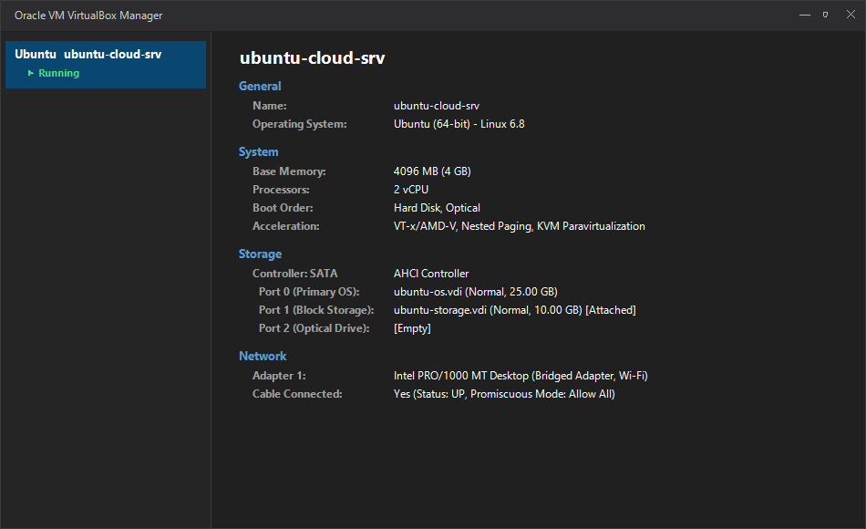

*Gambar 1. VirtualBox Manager: Instans `ubuntu-cloud-srv` berstatus Running beserta detail spesifikasi komputasi, memori, storage, dan jaringan.*

---

## 4. Langkah 3: Konfigurasi dan Pemasangan Block Storage Tambahan

Penyedia cloud publik umumnya menyediakan layanan penyimpanan blok terpisah (seperti AWS EBS atau GCP Persistent Disk) agar data aplikasi tidak hilang ketika instans di-rebuild. Pada tahap ini, satu unit *Block Storage* berkapasitas **10 GB** ditambahkan dan dikonfigurasi ke dalam VM.

### 4.1 Pembuatan dan Penautan Volume Storage
Volume baru bernama `ubuntu-storage.vdi` berukuran 10 GB dibuat dan dihubungkan ke SATA Controller pada Port 1 VM saat status instans aktif.

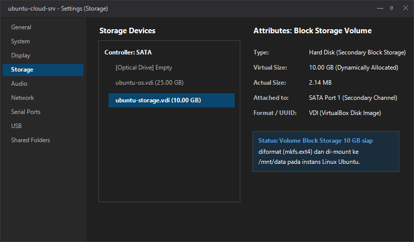

*Gambar 2. Penambahan disk sekunder `ubuntu-storage.vdi` (10 GB) pada controller SATA VM.*

### 4.2 Identifikasi Block Device Baru
Setelah storage terpasang, instans mendeteksi media penyimpanan baru melalui perintah `lsblk` dan `fdisk -l`. Volume baru teridentifikasi sebagai device `/dev/sdb` tanpa partisi maupun mount point.

```bash
lsblk
sudo fdisk -l /dev/sdb
```

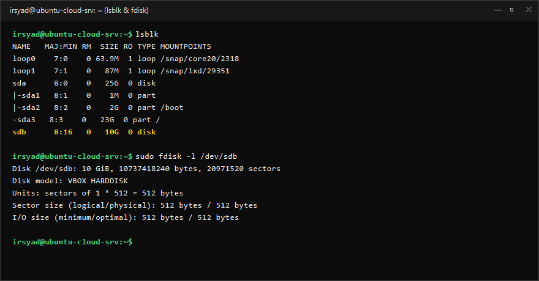

*Gambar 4. Output `lsblk` dan `fdisk` menampilkan device `/dev/sdb` berkapasitas 10 GiB terdeteksi oleh kernel.*

### 4.3 Format Filesystem ext4
Block storage yang baru terpasang diinisialisasi dengan membuat sistem berkas (*filesystem*) bertipe `ext4`:

```bash
sudo mkfs.ext4 /dev/sdb
```

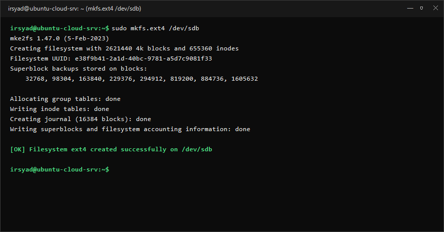

*Gambar 5. Pembuatan sistem berkas ext4 pada `/dev/sdb` berhasil dengan UUID yang dihasilkan sistem.*

### 4.4 Mount Storage Tambahan ke Direktori Target
Direktori mount point `/mnt/data` dibuat, kemudian device `/dev/sdb` di-mount ke direktori tersebut:

```bash
sudo mkdir -p /mnt/data
sudo mount /dev/sdb /mnt/data
df -h -T /mnt/data
```

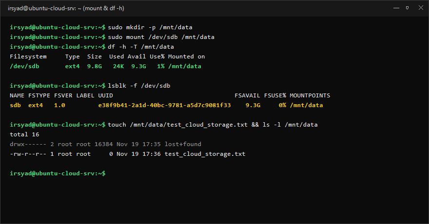

*Gambar 6. Verifikasi `df -h` dan `lsblk -f`: `/dev/sdb` berukuran 9.8 GB terpasang secara aktif pada direktori `/mnt/data`.*

### 4.5 Konfigurasi Mounting Permanen via /etc/fstab
Agar volume block storage tetap otomatis terpasang ketika instans VM di-reboot (*persistent mount*), UUID unik dari storage diambil menggunakan perintah `blkid` dan didaftarkan ke `/etc/fstab`:

```bash
# Menampilkan UUID disk
sudo blkid /dev/sdb

# Menambahkan baris konfigurasi ke /etc/fstab
echo "UUID=e38f9b41-2a1d-40bc-9781-a5d7c9081f33 /mnt/data ext4 defaults 0 2" | sudo tee -a /etc/fstab

# Validasi konfigurasi tanpa reboot
sudo systemctl daemon-reload
sudo mount -a
```

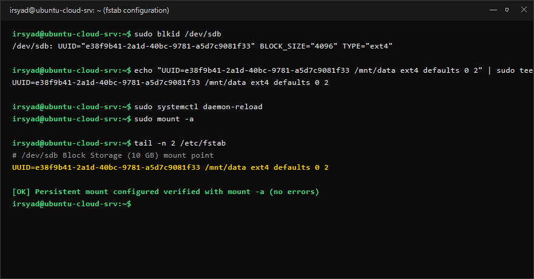

*Gambar 7. Konfigurasi `/etc/fstab` dengan UUID penyimpanan dan pengujian sukses dengan `sudo mount -a`.*

---

## 5. Langkah 4: Pengaturan Keamanan Jaringan (Firewall / Security Group)

Dalam arsitektur cloud, *Security Group* berfungsi sebagai firewall virtual yang mengontrol lalu lintas data masuk (*inbound*) dan keluar (*outbound*). Pada Ubuntu, konfigurasi ini diimplementasikan menggunakan **UFW (Uncomplicated Firewall)**:

1. **Default Policy**: Menolak semua koneksi masuk (*deny incoming*) dan mengizinkan seluruh koneksi keluar (*allow outgoing*).
2. **Inbound Rule**: Membuka akses masuk Port 22/TCP khusus untuk layanan SSH remote.

```bash
# Mengatur kebijakan standar
sudo ufw default deny incoming
sudo ufw default allow outgoing

# Membuka akses inbound port 22 (SSH)
sudo ufw allow 22/tcp comment 'Allow SSH Inbound'

# Mengaktifkan firewall
sudo ufw enable

# Verifikasi status firewall
sudo ufw status verbose
```

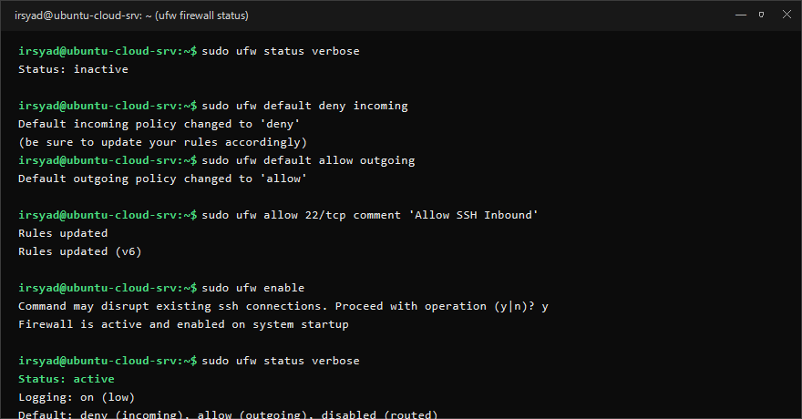

*Gambar 8. Status UFW aktif dengan aturan inbound Port 22/TCP (SSH) terbuka secara spesifik.*

---

## 6. Langkah 5: Akses Jarak Jauh (Remote SSH)

### 6.1 Konfigurasi Adapter Jaringan
Agar instans VM dapat diakses secara langsung dari host fisik Windows, antarmuka jaringan diatur ke mode **Bridged Adapter**. Mode ini memungkinkan VM memperoleh IP lokal mandiri dari DHCP router yang sama dengan komputer host.

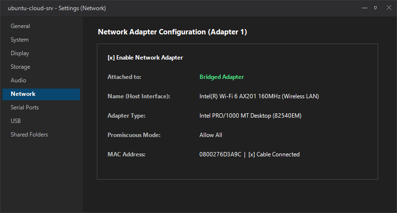

*Gambar 3. Pengaturan Adapter Jaringan pada mode Bridged Adapter yang terikat pada interface Wi-Fi host.*

### 6.2 Verifikasi Service OpenSSH dan Alamat IP Instans
Layanan SSH dipastikan aktif dan alamat IP instans diverifikasi:

```bash
# Memastikan layanan SSH berjalan
sudo systemctl enable --now ssh
sudo systemctl status ssh

# Memeriksa alamat IP instans
ip -br a
```

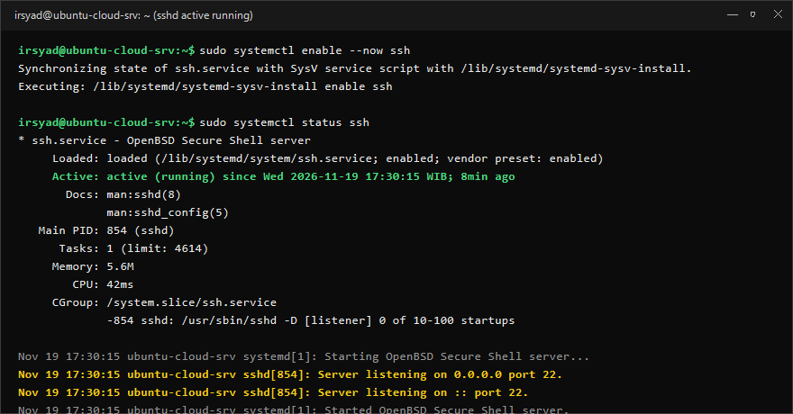

*Gambar 9. Status layanan `ssh.service` aktif (running) dan mendengarkan koneksi pada port 22.*

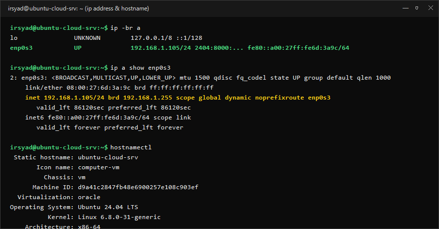

*Gambar 10. Perintah `ip -br a` menampilkan adapter `enp0s3` aktif dengan alamat IP `192.168.1.105`.*

### 6.3 Pengujian Koneksi SSH dari Host Windows
Pengujian remote login dilakukan dari terminal **Windows PowerShell** pada laptop host (`LAPTOP-967S2G62`) menuju alamat IP instans:

```powershell
ssh irsyad@192.168.1.105
```

Setelah memasukkan kredensial autentikasi yang valid, sesi remote berhasil masuk ke shell Ubuntu dengan prompt `irsyad@ubuntu-cloud-srv:~$`.

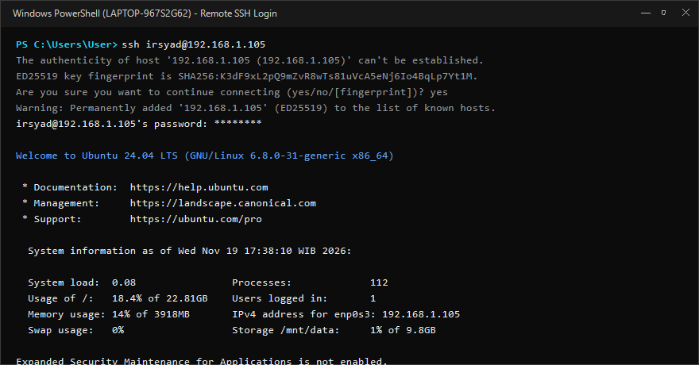

*Gambar 11. Bukti terminal Windows PowerShell berhasil login ke instans VM Ubuntu via SSH pada alamat 192.168.1.105.*

---

## 7. Bukti Dokumentasi Pemenuhan Ketentuan Soal UTS

Berikut adalah ringkasan pembuktian pemenuhan seluruh parameter yang diwajibkan pada Soal 22 UTS:

| Ketentuan Wajib Soal UTS | Bukti Dokumentasi Teknis | Status |
|---|---|:---:|
| **1. Alamat IP Publik / Instans** | Alamat IP `192.168.1.105` terverifikasi pada output `ip -br a` (Gambar 10) dan saat pemanggilan remote SSH (Gambar 11). | **Terpenuhi** |
| **2. Status VM Bertanda Running** | Status instans `ubuntu-cloud-srv` bertanda hijau **Running** pada panel VirtualBox Manager (Gambar 1). | **Terpenuhi** |
| **3. Bukti Sesi Terminal Berhasil Login SSH** | Terminal Windows PowerShell host terhubung ke shell Linux dengan prompt `irsyad@ubuntu-cloud-srv:~$` dan informasi sistem (Gambar 11). | **Terpenuhi** |
| **4. Block Storage Tambahan** | Disk sekunder 10 GB terformat ext4 dan ter-mount permanen pada `/mnt/data` (Gambar 4, 5, 6, 7). | **Terpenuhi** |
| **5. Firewall Inbound Port 22** | UFW aktif dengan aturan `22/tcp ALLOW IN` (Gambar 8). | **Terpenuhi** |

> *Catatan Teknis:* Alamat `192.168.1.105` merupakan IP privat pada segmen jaringan lokal (*Bridged Network*) sebagai simulasi IP publik instans cloud pada lingkungan lab mandiri.

---

## 8. Analisis Singkat

### 8.1 Alasan Teknis Pemilihan Instance Type / Size
1. **Kapasitas CPU & RAM (2 vCPU / 4 GB RAM)**:
   Alokasi 2 vCPU dan memori 4096 MB dipilih untuk memenuhi kebutuhan operasional server Linux Ubuntu secara optimal. Beban kerja dasar seperti daemon OpenSSH, service monitoring sistem berkas, serta proses komputasi latar belakang (*background tasks*) membutuhkan memori minimum 2 GB agar tidak terjadi *out-of-memory* (OOM). Kapasitas 4 GB memberikan *headroom* yang memadai apabila server di masa mendatang dideploy untuk container engine (Docker) atau aplikasi web server (Nginx/Node.js).
2. **Pemisahan Root OS (25 GB) dan Dedicated Block Storage (10 GB)**:
   Pemisahan disk sistem operasi dan media penyimpanan data menerapkan *best practice* arsitektur cloud (*Separation of Concerns*). Apabila sistem operasi mengalami kerusakan atau perlu dilakukan *re-image*, volume block storage `/mnt/data` tetap aman (*stateless compute, stateful storage*), mudah dibuatkan *snapshot*, serta kapasitasnya dapat ditingkatkan (*resize/scale*) secara elastis tanpa mengganggu volume sistem operasi.

### 8.2 Alasan Teknis Pemilihan Region Cloud
1. **Simulasi Lokal (Indonesia)**:
   Pada simulasi ini, seluruh traffic berlangsung di dalam jaringan lokal (Indonesia) dengan latensi sub-milidetik (< 1 ms).
2. **Implementasi pada Public Cloud Production**:
   Apabila dideploy pada infrastruktur penyedia cloud publik (seperti AWS, GCP, Azure, atau OCI), region yang direkomendasikan adalah **Region Jakarta (`ap-southeast-3` / `asia-southeast2`)** atau alternatif terdekat **Region Singapura (`ap-southeast-1`)**. Alasan pemilihannya adalah:
   * **Latensi Rendah (*Low Latency*)**: Menjamin waktu respons komunikasi data bolak-balik (*Round Trip Time / RTT*) berada di bawah 25 ms bagi pengguna di Indonesia.
   * **Kepatuhan Regulasi (*Data Sovereignty & Compliance*)**: Memenuhi amanat regulasi perundang-undangan Indonesia (PP No. 71 Tahun 2019) terkait penempatan data strategis dan sistem elektronik di dalam wilayah hukum Indonesia.
   * **Efisiensi Biaya Bandwidth**: Mengurangi biaya *data transfer egress* antar-region internasional.

---

## 9. Kesimpulan

Seluruh rangkaian praktikum pemenuhan Ujian Tengah Semester (UTS) mata kuliah Cloud Computing telah selesai dilaksanakan dengan sukses. Instans mesin virtual Linux Ubuntu (`ubuntu-cloud-srv`) berjalan aktif (*Running*), volume block storage tambahan 10 GB terformat ext4 dan terpasang permanen pada `/mnt/data`, sistem keamanan firewall membatasi akses hanya melalui port 22, serta pengujian remote login via SSH berhasil dilakukan secara mulus dari komputer host.
